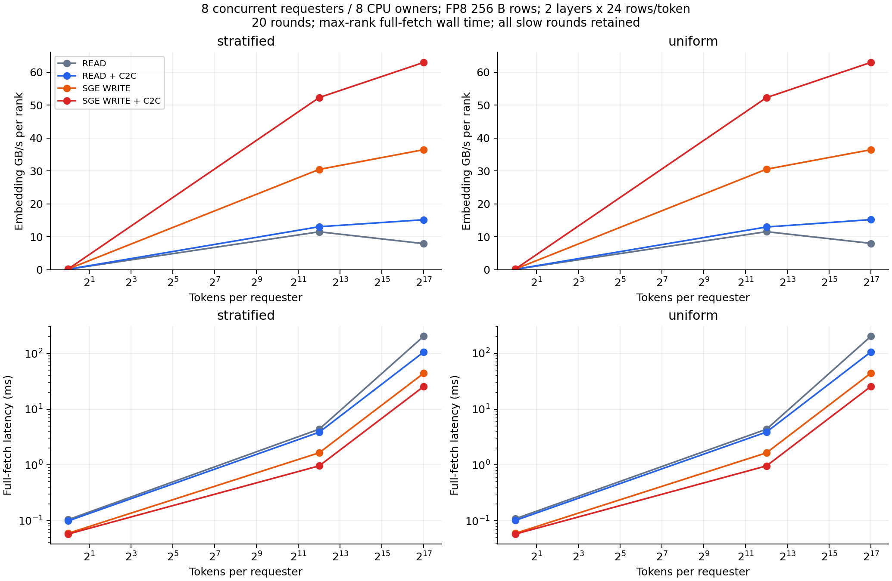

# 两套设计与 C2C 开关对照

每组20轮；每轮取8 ranks完整fetch wall time最大值，再取中位数。带宽仅计每rank逻辑embedding字节，包含本地查询；scales成本计入时间。不裁剪慢轮。

## stratified

| Tokens | READ ms / GB/s | READ+C2C ms / GB/s | WRITE ms / GB/s | WRITE+C2C ms / GB/s |
|---:|---:|---:|---:|---:|
| 1 | 0.1044 / 0.118 | 0.0990 / 0.124 | 0.0594 / 0.207 | 0.0575 / 0.214 |
| 4096 | 4.3770 / 11.499 | 3.8577 / 13.047 | 1.6516 / 30.475 | 0.9619 / 52.323 |
| 131072 | 203.9632 / 7.897 | 106.1629 / 15.171 | 44.1582 / 36.474 | 25.5586 / 63.016 |

## uniform

| Tokens | READ ms / GB/s | READ+C2C ms / GB/s | WRITE ms / GB/s | WRITE+C2C ms / GB/s |
|---:|---:|---:|---:|---:|
| 1 | 0.1093 / 0.112 | 0.1020 / 0.120 | 0.0599 / 0.205 | 0.0581 / 0.211 |
| 4096 | 4.3621 / 11.538 | 3.8836 / 12.960 | 1.6486 / 30.531 | 0.9625 / 52.292 |
| 131072 | 201.9069 / 7.977 | 105.9077 / 15.208 | 44.1732 / 36.461 | 25.5605 / 63.012 |

READ在部分大规模点存在运行波动，请同时查看均值、最大值和逐轮数据。两套设计的CPU服务线程、QP连接组织和staging资源不同。WRITE的forward控制由GPU发起/等待，owner CPU仍构造和提交SGE WRITE。

详见[UMR负向验证](UMR.md)与[异步forward验证](ASYNC.md)。
