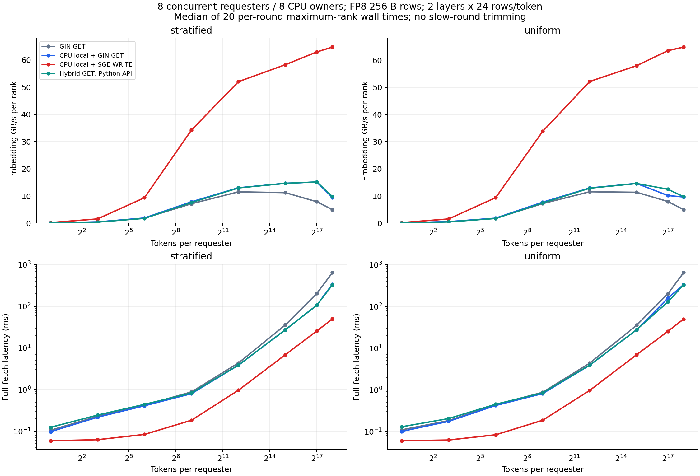
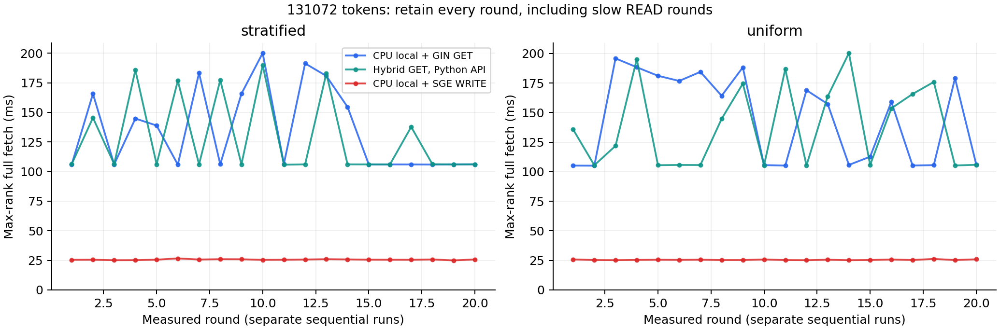

# 完整 fetch 对照结果

每个点为 20 轮、每轮 8 ranks 最大完整 fetch wall time 的中位数。
延迟以 ms、带宽以十进制 GB/s 表示；带宽只计每 rank embedding 字节，scales 处理包含在时间内。
所有轮次均保留，均值、最大值见 `summary.csv`，逐轮值见 `summary.json` 与 `raw/`。

## stratified

| Tokens | READ ms / GB/s | 混合 READ ms / GB/s | WRITE ms / GB/s | WRITE / 混合 READ 带宽 | 混合 READ API ms |
|---:|---:|---:|---:|---:|---:|
| 1 | 0.1055 / 0.116 | 0.0974 / 0.126 | 0.0589 / 0.209 | 1.65x | 0.1240 |
| 8 | 0.2276 / 0.432 | 0.2169 / 0.453 | 0.0625 / 1.573 | 3.47x | 0.2439 |
| 64 | 0.4230 / 1.859 | 0.4092 / 1.922 | 0.0838 / 9.384 | 4.88x | 0.4422 |
| 512 | 0.8793 / 7.155 | 0.7988 / 7.876 | 0.1836 / 34.273 | 4.35x | 0.8272 |
| 4096 | 4.3664 / 11.527 | 3.8637 / 13.027 | 0.9671 / 52.044 | 4.00x | 3.8822 |
| 32768 | 35.8668 / 11.226 | 27.4539 / 14.667 | 6.9093 / 58.277 | 3.97x | 27.4781 |
| 131072 | 203.8676 / 7.900 | 106.3850 / 15.139 | 25.5815 / 62.960 | 4.16x | 106.1930 |
| 262144 | 644.9971 / 4.994 | 340.7562 / 9.453 | 49.7512 / 64.747 | 6.85x | 328.4569 |

## uniform

| Tokens | READ ms / GB/s | 混合 READ ms / GB/s | WRITE ms / GB/s | WRITE / 混合 READ 带宽 | 混合 READ API ms |
|---:|---:|---:|---:|---:|---:|
| 1 | 0.1096 / 0.112 | 0.1007 / 0.122 | 0.0600 / 0.205 | 1.68x | 0.1300 |
| 8 | 0.1829 / 0.537 | 0.1757 / 0.559 | 0.0626 / 1.571 | 2.81x | 0.2047 |
| 64 | 0.4393 / 1.790 | 0.4217 / 1.865 | 0.0836 / 9.412 | 5.05x | 0.4506 |
| 512 | 0.8726 / 7.210 | 0.8139 / 7.730 | 0.1863 / 33.773 | 4.37x | 0.8451 |
| 4096 | 4.3510 / 11.568 | 3.8831 / 12.962 | 0.9654 / 52.137 | 4.02x | 3.9096 |
| 32768 | 35.3998 / 11.374 | 27.5142 / 14.634 | 6.9476 / 57.956 | 3.96x | 27.5602 |
| 131072 | 201.6423 / 7.987 | 158.1581 / 10.184 | 25.3677 / 63.491 | 6.23x | 128.8036 |
| 262144 | 645.9241 / 4.987 | 333.8935 / 9.647 | 49.7050 / 64.807 | 6.72x | 330.1613 |

## 口径

READ 是同一精简 DeepEP Engram 中关闭本地 CPU 直读的对照，包含已验证的 CUSTOM_STRIDE representative-rank 修正。混合 READ 同机直接加载 CPU 词表、跨机 GIN GET。WRITE 同机直接加载 CPU 词表，跨机由 CPU owner 构造 30-SGE verbs WRITE，并包含 GPU 分组、请求、DONE 和重排。

每轮索引不同且两条路径使用同一 C++ mt19937 规则。词表、输出容量和配置相同。READ 使用 G=4 custom-stride rail 和 owner CPU 注册别名；WRITE 为各远端 owner/requester 对建立 RC 数据通道，NCCL_CROSS_NIC 只约束其 GIN 控制面。WRITE 每 rank 使用 4 个 CPU owner 服务线程及额外 staging / positions；READ 无每次查询的 CPU owner 服务。两者的 QP 组织、CPU 服务与排队机制不同，属于应用设计对照。

主对照均为 CUDA Graph；API 列是普通 Python fetch/hook 的完整 fetch 时延；Graph/API 在不同进程中顺序运行，大规模测点不可直接相减作为 Python 开销。初始化、上游输入生成/上传和完整正确性校验不计入 fetch。

## 131072 tokens 的运行波动

混合 READ 在约 105 ms 的快轮与更慢轮之间呈现明显波动。中位数会受慢轮比例影响；同时查看均值和逐轮数据。Graph/API 为顺序独立运行，不把二者中位数差额当作 Python 时间。

| 分布 | 模式 | 中位数 ms | 均值 ms | 最小 ms | 最大 ms |
|---|---|---:|---:|---:|---:|
| stratified | hybrid-read | 106.385 | 134.628 | 105.887 | 200.129 |
| stratified | hybrid-read-api | 106.193 | 128.787 | 105.799 | 189.972 |
| stratified | write | 25.581 | 25.637 | 24.980 | 26.655 |
| uniform | hybrid-read | 158.158 | 144.975 | 105.079 | 195.817 |
| uniform | hybrid-read-api | 128.804 | 138.382 | 105.276 | 200.323 |
| uniform | write | 25.368 | 25.486 | 25.185 | 26.239 |

